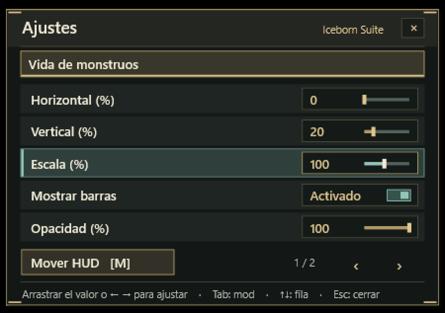

# Iceborn Suite Core

The shared DX11 runtime for **Monster Hunter World: Iceborne**. Core loads the suite’s trackers and draws their panels and settings in the game.

**0.1.0-dev.19 — DX11 release candidate.** The prepared tracker packages include this version of Core. The screenshots and Spanish gameplay check below come from that candidate. The latest runtime source on `main` is [dev.18](https://github.com/EnzoAlzueta/IcebornSuiteCore/commit/ddc766576a56b434c96e887d9139d3d3a998183d).

[Install](#install) · [Controls](#default-controls) · [Language](#language) · [Validation](#validation) · [Build](#build-and-contribute)

## Features

- Load Monster Info, Buff Tracker and Crown Tracker independently.
- Move and resize supported panels without leaving the game.
- Reuse the last rendered HUD while the displayed values are unchanged.

## Install

Close the game. From Steam, choose **Manage → Browse local files**. Extract one ZIP into the folder containing `MonsterHunterWorld.exe` and keep the directory structure.

| Your setup | ZIP to use |
|---|---|
| Clean game folder with no root loader | **Clean Install** includes the suite bootstrap. |
| Stracker already loads plugins, or the suite bootstrap works | **Existing Loader** installs the files under `nativePC`. |
| Adding a second tracker to this release | **Existing Loader** uses the same shared Core files. |

Keep any existing root loader, settings and hunt files. The standalone Damage Meter bootstrap loads only the meter. Running both mods requires a loader that also loads the suite adapter from `nativePC/plugins`. Keep newer shared files when adding an older package.

## Default controls

| Key or setting | Action |
|---|---|
| F6 | Open settings when an installed module provides a settings page. |
| Tab | Switch between available pages. |
| F10 | Open Core settings when a legacy Damage Meter owns F6. |

## Using Core with Damage Meter

The suite-development meter can share the settings menu. The public standalone meter keeps its own controls. Use F10 for Core when it detects a legacy meter. A working plugin loader is required to load both DLLs together.

## Language

The HUD follows the game language selected in Steam. Supported languages are English, Spanish, Portuguese, French, German, Italian, Japanese, Korean, Simplified Chinese, Traditional Chinese, Russian, Polish and Arabic. Latin American Spanish uses Spanish menus and its own game text. The menu, monster names and supported timer labels follow this setting. To override detection, set Language under `[ui]` in `nativePC/IcebornSuite/user/core.ini` (for example, `Language=es-419`). Restart after editing the file.

## Requirements and limits

Monster Hunter: World / Iceborne on Windows x64, supported Steam executable build 421810 and DirectX 11.

Core alone has no gameplay panel. The menu shown in the images has Monster Info installed.

## Validation

Core dev.18 ran alongside Damage Meter and all three trackers during a solo DX11 hunt. The earlier dev.17/dev.18 performance comparison used one 60-second in-game run per version.

In a solo DX11 hunt on Steam build 421810 (quest 67106), the player confirmed the Spanish settings menu and the name Gran Jagras on the health bar. Both load orders with the suite-development Damage Meter also passed isolated tests in Spanish.

Isolated DX11 rendering tests with Core dev.19 covered all 13 interface languages and the Latin American Spanish variant.

## Troubleshooting and removal

Check `nativePC/IcebornSuite/user/core-dev5.log` for the supported build and loaded modules. Preserve `core.ini` and the Damage Meter settings, history and hunt archive.

To remove Core, first remove or disable the trackers that use it. Close the game and remove `nativePC/plugins/iceborn_suite_adapter.dll` and `nativePC/IcebornSuite/runtime/0.1.0-dev.19/iceborn_suite_core.dll`. Remove the suite root bootstrap only if you installed the Clean Install version and it still belongs to this suite.

## Build and contribute

Run `build-core.cmd` with the Visual Studio C++ x64 build tools installed. The optional graphics fixture accepts a built Monster Info module. See [the SDK notes](CONTRACT-STATUS.md) for the versioned contracts.

Include your Core and module versions, loader, game language and reproduction steps in [bug reports](https://github.com/EnzoAlzueta/IcebornSuiteCore/issues).

## License and notices

Iceborn Suite by Enzo. The shared runtime includes code from Iceborn Damage Meter (MIT) and MinHook (BSD 2-Clause). The package includes the third-party notices. CAPCOM owns the localized game text and the arena artwork in the gallery.

## AI disclosure

OpenAI Codex helped prepare the documentation and mod-page text. The preview uses the suite’s HUD renderer and sample data.

## Iceborn Suite projects

- [IcebornDamageMeter](https://github.com/EnzoAlzueta/IcebornDamageMeter)
- [IcebornMonsterInfo](https://github.com/EnzoAlzueta/IcebornMonsterInfo)
- [IcebornBuffTracker](https://github.com/EnzoAlzueta/IcebornBuffTracker)
- [IcebornCrownTracker](https://github.com/EnzoAlzueta/IcebornCrownTracker)
- [IcebornHuntAnalyzer](https://github.com/EnzoAlzueta/IcebornHuntAnalyzer) (planning)
- [IcebornToolTracker](https://github.com/EnzoAlzueta/IcebornToolTracker) (planning)
